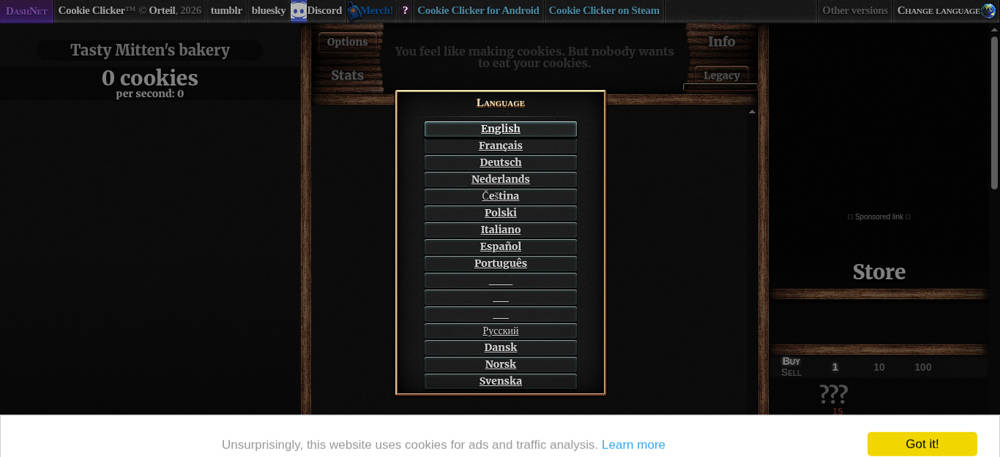
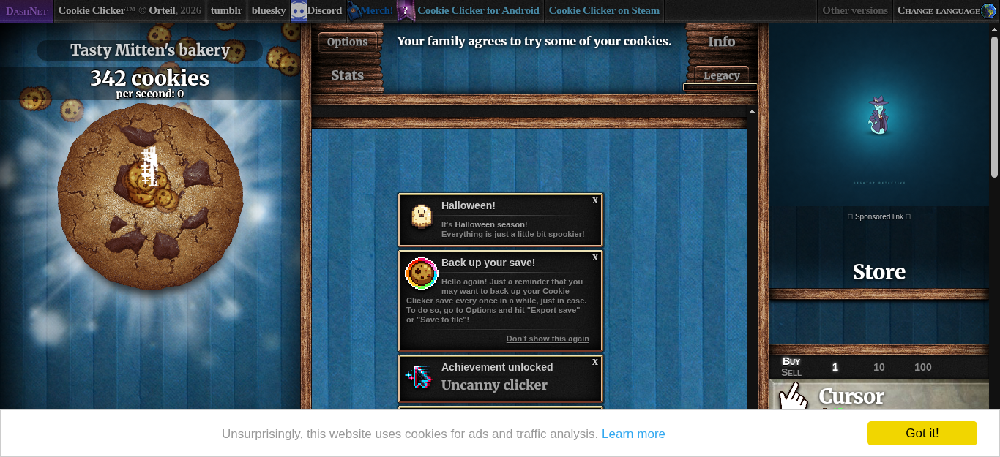
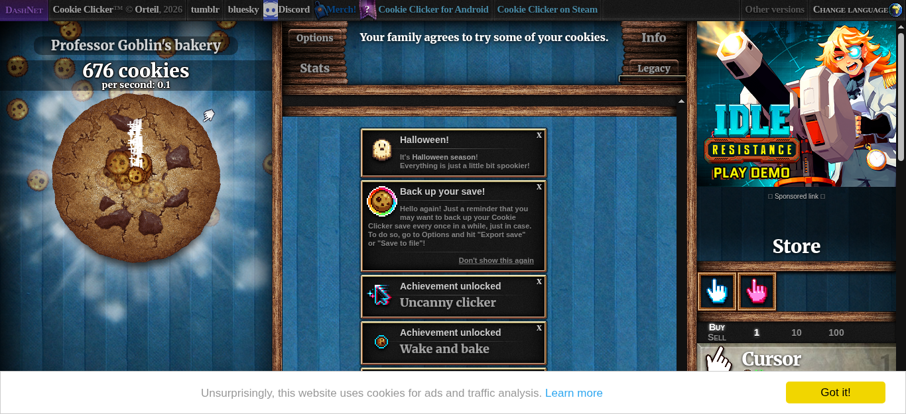
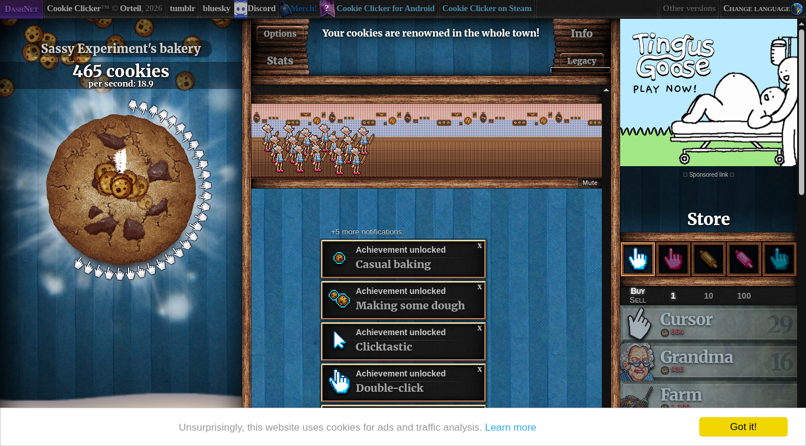
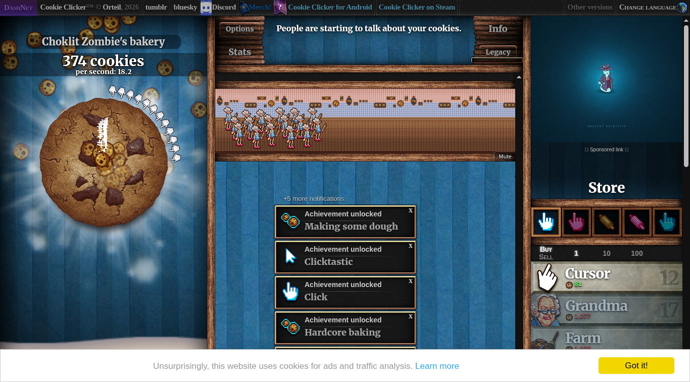

# 🍪 Cookie Clicker Bot

A Selenium bot that plays [Cookie Clicker][game] for you: it clicks the big cookie, buys the most expensive upgrade it can afford every 5 seconds and prints the cookies per second after 5 minutes. It is the solution to day 48 of Udemy's *100 Days of Code: The Complete Python Pro Bootcamp*, written for course participants who want to compare solutions and for visitors who browse for ideas.

## 📚 Table of Contents

- [Overview](#-overview)
- [Requirements](#-requirements)
- [Setup](#-setup)
- [Run](#-run)
- [Tests](#-tests)
- [License](#-license)
- [Links](#-links)
- [Appendix: Project documents](#-appendix-project-documents)

## 🧭 Overview

The bot follows the five steps of the lecture:

1. Get to know the game.
2. Click the cookie as fast as possible, after dismissing the language selection.
3. Every 5 seconds buy the most expensive upgrade you can afford.
4. After 5 minutes stop and print `cookies/second`.
5. Tweak the strategy (check interval, buy one or buy all affordable).

### The five steps in pictures

| Step | Screenshot |
| --- | --- |
| 1. Get to know the game |  |
| 2. Click the cookie |  |
| 3. Buy the most expensive affordable upgrade |  |
| 4. Stop after 5 minutes, print cookies/second |  |
| 5. Tweak the strategy |  |

What each step taught is explained in the [wiki][documentation], in English, Danish and Bahasa Malaysia (the same pages are in `docs/wiki/`).

The repository is organised like this:

| Folder or file | What it is for |
| --- | --- |
| `src/cookie_clicker_bot/` | The bot. `domain/` holds the rules (parsing, choosing the upgrade) with no Selenium, `application/` runs the game loop, `infrastructure/` drives the browser, `constants.py` holds every constant |
| `tests/` | `pytest` tests; the unit tests need no browser |
| `docs/` | Project documents, wiki pages (English, Danish, Bahasa Malaysia) and the screenshots of the lecture steps |
| `Dockerfile` | A Linux image with headless Chromium for real-browser runs and screenshots |
| `Doxyfile` | Doxygen configuration for the source comments |

## 📋 Requirements

- Python 3.13 or newer.
- Selenium (the only runtime dependency; it is installed by `pip` and finds the browser driver itself).
- Google Chrome or Chromium to run the bot on your own machine.
- `pytest` and `pytest-cov` for the tests (development extra only).
- Docker, only if you want to run the bot or take screenshots without opening a window on your desktop.
- Doxygen, only to build the source documentation.

## 🛠️ Setup

Create a local virtual environment, upgrade `pip` and install the project with the test tools:

```bash
python -m venv .venv
```

Activate it:

```bash
# Linux and macOS
source .venv/bin/activate
```

```powershell
# Windows PowerShell
.venv\Scripts\Activate.ps1
```

```bash
python -m pip install --upgrade pip
python -m pip install -e ".[dev]"
```

Leave the environment with `deactivate`. The folder `.venv` is ignored by git.

## ▶️ Run

With the environment active:

```bash
cookie-clicker-bot
```

or, without installing the command:

```bash
python -m cookie_clicker_bot
```

The bot plays for 5 minutes, then prints one line on standard output, for example `cookies/second: 18.9`. What it did (clicks, purchases, time) is logged on standard error. Options:

| Option | What it does | Default |
| --- | --- | --- |
| `--duration SECONDS` | How long to play | 300 |
| `--interval SECONDS` | Time between upgrade checks (greater than 0) | 5 |
| `--buy-all` | Buy every affordable upgrade, most expensive first, instead of one | off |
| `--best-value` | Buy the affordable upgrade with the lowest price per cookie per second (not together with `--buy-all`) | off |
| `--headless` | Run Chromium without a window | off (on in Docker) |
| `--screenshot PATH` | Save a screenshot when the run ends | none |
| `--screenshot-start PATH` | Save a screenshot before the first click | none |

To keep your desktop free, run it in the Docker container (headless Chromium). Options go after the image name:

```bash
docker build -t cookie-clicker-bot .
docker run --rm cookie-clicker-bot
docker run --rm cookie-clicker-bot --headless --interval 10
```

## 🧪 Tests

```bash
python -m pytest
```

Coverage of the logic modules is checked with `python -m pytest --cov`. Tests that need a real browser are marked `browser` and run in the Docker container; all other tests need neither a browser nor the network.

Build the source documentation with Doxygen:

```bash
doxygen Doxyfile
```

## 📄 License

GNU Affero General Public License v3.0, see [LICENSE][license].

## 🔗 Links

- [Repository][repository]
- [Documentation][documentation]
- [Issue tracker][issues]

## 📎 Appendix: Project documents

The documents a newcomer needs, in reading order.

| Document | What it tells you |
| --- | --- |
| [AGENTS.md][agents] | The rules AI agents follow in this repository |
| [Business Case][BC-001] | Why the project exists, its scope and success criteria |
| [Stakeholder Analysis][SA-001] | Who is involved; the stakeholder IDs used for owners and reviewers |
| [Project Plan][PP-001] | The gateways and their schedule |
| [Milestones][milestones] | One document per gateway: Go/No-Go criteria and tasks |
| [Artifact registry][registry] | Where each artifact type lives, the next version, the PO language and domain |
| [Domain dictionary][DICT-001] | The PO terms and the IT terms |
| [Traceability matrix][TM-001] | How the artifacts link and when each was last reviewed |
| [Framework README][framework-readme] | The framework this project uses |
| [Framework changelog][framework-changelog] | What changed in each framework release |

---

[game]: https://ozh.github.io/cookieclicker/
[license]: ./LICENSE
[repository]: https://git.tirsystem.com/Tirsvad-Udemy-100-days-of-code/048-the-coockie-factory-new
[documentation]: https://git.tirsystem.com/Tirsvad-Udemy-100-days-of-code/048-the-coockie-factory-new/wiki
[issues]: https://git.tirsystem.com/Tirsvad-Udemy-100-days-of-code/048-the-coockie-factory-new/issues
[agents]: ./AGENTS.md
[BC-001]: ./docs/business-case.md
[SA-001]: ./docs/stakeholder-analysis.md
[PP-001]: ./docs/project-plan.md
[milestones]: ./docs/milestones/
[registry]: ./docs/artifact-registry.md
[DICT-001]: ./docs/dictionary.md
[TM-001]: ./docs/sqa/traceability-matrix.md
[framework-readme]: ./framework/README.md
[framework-changelog]: ./framework/CHANGELOG.md
