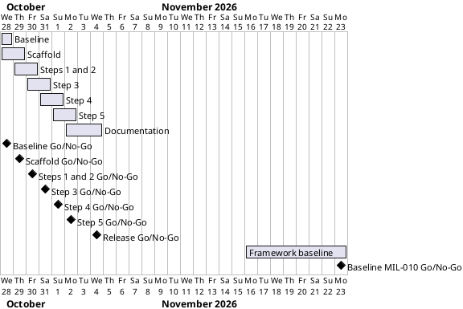

# Project Plan: Cookie Clicker Bot

## Metadata
| Key | Value |
| --- | --- |
| ID | PP-001 |
| CrossReference | [BC-001], [SA-001], [MIL-001], [MIL-002], [MIL-003], [MIL-004], [MIL-005], [MIL-006], [MIL-007], [MIL-008], [MIL-009], [MIL-010] |
| Language | en |
| Domain | education |

## Version History
| Date | Status | Author | Reviewer | Change | Commit |
| --- | --- | --- | --- | --- | --- |
| 2026-10-28 | Deprecated | Jens Tirsvad Nielsen | S01 | Add MIL-008 (smarter purchase rule); accepted by S01 in chat | [9a6796f] |
| 2026-10-29 | Deprecated | Jens Tirsvad Nielsen | S01 | Add MIL-009 (Home pages show the best value result); accepted by S01 in chat | [72faffa] |
| 2026-11-16 | Accepted | Jens Tirsvad Nielsen | AI as stand-in for S01 | Added the baseline gateway MIL-010 with its schedule row, scope coverage, dependency, risk and Gantt entries; recorded the move of the end date, the domain, the live-site rule and the stale wiki-publish remark in the Planning Assumptions and Open Issues; set the domain to education; reviewed in autonomous mode, not independent | [3b831e6] |

---

## Purpose

This plan schedules ten gateways (`MIL-001` to `MIL-010`) that take the Cookie Clicker bot from an accepted baseline to a documented, tested and published repository. The Business Case sets no deadline, so the window 2026-10-28 to 2026-11-04 is a planning assumption of this plan. Each gateway ends in a decision and a deliverable and is delivered by one pull request on its own branch. The tenth gateway, the framework baseline ([MIL-010]), brings the finished project to the common baseline of the framework.

## Planning Assumptions

- Week 1 starts 2026-10-28; the plan ends by 2026-11-04 (a planning assumption, see Open Issues).
- Phase length: one day per gateway, except the baseline and documentation, which are longer. Gateways 003 to 006 follow the Udemy lecture steps 1 to 5.
- One branch and one pull request per gateway, each closing the issues of its tasks.
- The user stories and use case steps of the journey are skipped for this project (ADR-0001), so no gateway lists stories.
- Autonomous mode: S01 accepts this plan in chat; the AI acts as stand-in reviewer and records it in each `RC-*`.
- The baseline gateway MIL-010 starts 2026-11-16 and ends 2026-11-23, one week (source: [BC-001], Constraints). It brings the finished project to the baseline of the framework, a decision of S01. The decision dates of the earlier gateways stay as they were; the window of [MIL-008] (2026-11-05 to 2026-11-06) already lay after the plan end of 2026-11-04, so the end date of the plan moves from 2026-11-04 to 2026-11-23.
- For MIL-010 S01 has authorised the assistant to commit, push, open the pull request and merge it, and the review is done by an AI stand-in for S01 (source: [BC-001], Constraints and Risks).

## Gateway Schedule

| Gateway | Document | Window | Decision date | Owner | Stories | Main deliverable | Milestone |
| --- | --- | --- | --- | --- | --- | --- | --- |
| Baseline and repository set-up | [MIL-001] | 2026-10-28 | 2026-10-28 | S01 | none (documents) | Accepted baseline, ADRs, repository description and topics | [Milestone 1] |
| Project scaffold and tooling | [MIL-002] | 2026-10-28 to 2026-10-29 | 2026-10-29 | S01 | none (technical tasks) | `pyproject.toml`, layout, `.gitignore`, Doxyfile, README, Docker image | [Milestone 2] |
| Lecture steps 1 and 2 | [MIL-003] | 2026-10-29 to 2026-10-30 | 2026-10-30 | S01 | none (technical tasks) | Open game, dismiss language, click cookie, screenshots 1 and 2 | [Milestone 3] |
| Lecture step 3 | [MIL-004] | 2026-10-30 to 2026-10-31 | 2026-10-31 | S01 | none (technical tasks) | Parsing, selection rule, purchase every 5 s, screenshot 3 | [Milestone 4] |
| Lecture step 4 | [MIL-005] | 2026-10-31 to 2026-11-01 | 2026-11-01 | S01 | none (technical tasks) | 5 minute run, cookies per second, screenshot 4 | [Milestone 5] |
| Lecture step 5 | [MIL-006] | 2026-11-01 to 2026-11-02 | 2026-11-02 | S01 | none (technical tasks) | Strategy options, comparison, screenshot 5 | [Milestone 6] |
| Documentation, wiki and release | [MIL-007] | 2026-11-02 to 2026-11-04 | 2026-11-04 | S01 | none (documentation) | README, Doxygen, wiki in en, da and ms, final checks | [Milestone 7] |
| Smarter purchase rule | [MIL-008] | 2026-11-05 to 2026-11-06 | 2026-11-06 | S01 | none (technical tasks) | Best value strategy, measured comparison, wiki note in en, da and ms | [Milestone 8] |
| Home pages show the best value result | [MIL-009] | 2026-10-29 to 2026-10-30 | 2026-10-30 | S01 | none (documentation) | Results row and --best-value note on the wiki Home pages in en, da and ms | [Milestone 9] |
| Framework baseline | [MIL-010] | 2026-11-16 to 2026-11-23 | 2026-11-23 | S01 | none (technical tasks) | Branch `mil-010-framework-baseline` merged: the adopted framework release, the wiki sidebar in the framework's shape, the README, licence and project URL metadata, the traceability matrix and review records | [Milestone 567] |



## Scope Coverage

| Business Case scope item | Gateway |
| --- | --- |
| Selenium bot for the game, with the assignment's function names | MIL-003, MIL-004, MIL-005 |
| Lecture steps 1 to 5 | MIL-003 (1 and 2), MIL-004 (3), MIL-005 (4), MIL-006 (5) |
| Python project files: `src/`, `tests/`, `docs/`, `pyproject.toml`, `constants.py`, `.gitignore`, Doxyfile, README | MIL-002, MIL-007 |
| Unit tests with `pytest` | MIL-002 to MIL-006 |
| One screenshot per lecture step in README and wiki | MIL-003 to MIL-006 (capture), MIL-007 (use) |
| Wiki in en, da and ms | MIL-007 |
| Repository description and topics | MIL-001 |
| The baseline: framework release, wiki sidebar shape, README, licence and project URL metadata, traceability matrix, review records (objective O7) | MIL-010 |

## Dependencies

```
MIL-001 → MIL-002 → MIL-003 → MIL-004 → MIL-005 → MIL-006 → MIL-007 → MIL-008 → MIL-009 → MIL-010
```

A No-Go on a gateway stops all later gateways until it is fixed and re-reviewed. The end date then moves by the days spent on the rework; S01 decides a move of the end date; for MIL-010 it moved to 2026-11-23.

## Plan Risks

| Risk | Impact | Mitigation |
| --- | --- | --- |
| The game changes its page structure (Business Case risk: page changes) | Steps 1 to 4 need rework | Selectors only in `constants.py`; the first task records the page as seen |
| The headless container cannot run the game well | Screenshots and the 5 minute run are late | Try the container in MIL-002; pin Chromium; fall back to a shorter duration constant for tests only |
| Stand-in review misses a defect | Defect reaches `main` | `RC-*` marks the review as not independent; S01 reviews the final summary |
| Translations take longer than planned | MIL-007 slips | Write English first; da and ms follow page by page; no extra pages |
| A continuous integration (CI) check fails on the pull request of MIL-010 | The merge is delayed past 2026-11-23 | The failure is fixed on the same branch and the checks run again; after three failed rounds on one cause the work stops and S01 decides (trace: success criterion 9 of [BC-001]) |

## Open Issues

- Resolved: S01 accepted the plan in chat on 2026-10-28; the target repository is `origin`, as S01 confirmed.
- Domain: since [MIL-010] the plan, the Business Case and the baseline milestone have the domain `education`. The other documents (Stakeholder Analysis, Domain Dictionary, milestones MIL-001 to MIL-009 and the review records RC-001 to RC-021) keep the domain `it` they were accepted with; they are not changed by the baseline, and a change of their domain would need a new review of each.
- Live services: running the bot opens the real Cookie Clicker page at ozh.github.io in Chrome and plays the game; it submits nothing and uses no account or personal data. MIL-010 opens no web page, starts no browser and runs no container; the tests use fakes. The reader checks the terms of use of a site before running the program against it.
- The wiki task of [MIL-007] (task 6) names a publish workflow template or the wiki token as the way to publish; the repository has no workflow file of its own and the wiki is published by the shared workflows of the git host. The accepted [MIL-007] is not changed.

---

[BC-001]: ./business-case.md
[SA-001]: ./stakeholder-analysis.md
[MIL-001]: ./milestones/mil-001-baseline.md
[MIL-002]: ./milestones/mil-002-scaffold.md
[MIL-003]: ./milestones/mil-003-click-bot.md
[MIL-004]: ./milestones/mil-004-buy-upgrades.md
[MIL-005]: ./milestones/mil-005-timed-run.md
[MIL-006]: ./milestones/mil-006-strategy.md
[MIL-007]: ./milestones/mil-007-documentation.md
[MIL-008]: ./milestones/mil-008-smarter-rule.md
[MIL-009]: ./milestones/mil-009-home-results.md
[cadc5ef]: https://git.tirsystem.com/Tirsvad-Udemy-100-days-of-code/048-the-coockie-factory-new/commit/cadc5eff21d9afc09799d4bc2e3f6ac17ab2612a
[Milestone 1]: https://git.tirsystem.com/Tirsvad-Udemy-100-days-of-code/048-the-coockie-factory-new/milestone/290
[Milestone 2]: https://git.tirsystem.com/Tirsvad-Udemy-100-days-of-code/048-the-coockie-factory-new/milestone/291
[Milestone 3]: https://git.tirsystem.com/Tirsvad-Udemy-100-days-of-code/048-the-coockie-factory-new/milestone/292
[Milestone 4]: https://git.tirsystem.com/Tirsvad-Udemy-100-days-of-code/048-the-coockie-factory-new/milestone/293
[Milestone 5]: https://git.tirsystem.com/Tirsvad-Udemy-100-days-of-code/048-the-coockie-factory-new/milestone/294
[Milestone 6]: https://git.tirsystem.com/Tirsvad-Udemy-100-days-of-code/048-the-coockie-factory-new/milestone/295
[Milestone 7]: https://git.tirsystem.com/Tirsvad-Udemy-100-days-of-code/048-the-coockie-factory-new/milestone/296
[Milestone 8]: https://git.tirsystem.com/Tirsvad-Udemy-100-days-of-code/048-the-coockie-factory-new/milestone/308
[Milestone 9]: https://git.tirsystem.com/Tirsvad-Udemy-100-days-of-code/048-the-coockie-factory-new/milestone/309
[9a6796f]: https://git.tirsystem.com/Tirsvad-Udemy-100-days-of-code/048-the-coockie-factory-new/commit/9a6796f775680effe37a54f2609c3915140c8c0e
[72faffa]: https://git.tirsystem.com/Tirsvad-Udemy-100-days-of-code/048-the-coockie-factory-new/commit/72faffaff9e46bb294c7d55555a179af8d842443
[MIL-010]: ./milestones/mil-010-framework-baseline.md
[Milestone 567]: https://git.tirsystem.com/Tirsvad-Udemy-100-days-of-code/048-the-coockie-factory-new/milestone/567
[3b831e6]: https://git.tirsystem.com/Tirsvad-Udemy-100-days-of-code/048-the-coockie-factory-new/commit/3b831e6ee75cf4c8cd05443f2bed7e30df5b901a
