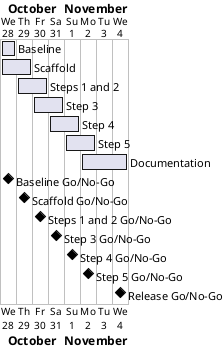

# Project Plan: Cookie Clicker Bot

## Metadata
| Key | Value |
| --- | --- |
| ID | PP-001 |
| CrossReference | [BC-001], [SA-001] |
| Language | en |
| Domain | it |

## Version History
| Date | Status | Author | Reviewer | Change | Commit |
| --- | --- | --- | --- | --- | --- |
| 2026-10-28 | Accepted | Jens Tirsvad Nielsen | S01 | Initial version: seven gateways; accepted by S01 in chat | [cadc5ef] |

---

## Purpose

This plan schedules seven gateways (`MIL-001` to `MIL-007`) that take the Cookie Clicker bot from an accepted baseline to a documented, tested and published repository. The Business Case sets no deadline, so the window 2026-10-28 to 2026-11-04 is a planning assumption of this plan. Each gateway ends in a decision and a deliverable and is delivered by one pull request on its own branch.

## Planning Assumptions

- Week 1 starts 2026-10-28; the plan ends by 2026-11-04 (a planning assumption, see Open Issues).
- Phase length: one day per gateway, except the baseline and documentation, which are longer. Gateways 003 to 006 follow the Udemy lecture steps 1 to 5.
- One branch and one pull request per gateway, each closing the issues of its tasks.
- The user stories and use case steps of the journey are skipped for this project (ADR-0001), so no gateway lists stories.
- Autonomous mode: S01 accepts this plan in chat; the AI acts as stand-in reviewer and records it in each `RC-*`.

## Gateway Schedule

| Gateway | Document | Window | Decision date | Owner | Stories | Main deliverable | Milestone |
| --- | --- | --- | --- | --- | --- | --- | --- |
| Baseline and repository set-up | [MIL-001] | 2026-10-28 | 2026-10-28 | S01 | none (documents) | Accepted baseline, ADRs, repository description and topics | [Milestone 1] |
| Project scaffold and tooling | [MIL-002] | 2026-10-28 to 2026-10-29 | 2026-10-29 | S01 | none (technical tasks) | `pyproject.toml`, layout, `.gitignore`, Doxyfile, README, Docker image | [Milestone 2] |
| Lecture steps 1 and 2 | [MIL-003] | 2026-10-29 to 2026-10-30 | 2026-10-30 | S01 | none (technical tasks) | Open game, dismiss language, click cookie, screenshots 1 and 2 | [Milestone 3] |
| Lecture step 3 | [MIL-004] | 2026-10-30 to 2026-10-31 | 2026-10-31 | S01 | none (technical tasks) | Parsing, selection rule, purchase every 5 s, screenshot 3 | [Milestone 4] |
| Lecture step 4 | [MIL-005] | 2026-10-31 to 2026-11-01 | 2026-11-01 | S01 | none (technical tasks) | 5 minute run, cookies per second, screenshot 4 | [Milestone 5] |
| Lecture step 5 | [MIL-006] | 2026-11-01 to 2026-11-02 | 2026-11-02 | S01 | none (technical tasks) | Strategy options, comparison, screenshot 5 | [Milestone 6] |
| Documentation, wiki and release | [MIL-007] | 2026-11-02 to 2026-11-04 | 2026-11-04 | S01 | none (documentation) | README, Doxygen, wiki in en, da and ms, final checks | [Milestone 7] |



## Scope Coverage

| Business Case scope item | Gateway |
| --- | --- |
| Selenium bot for the game, with the assignment's function names | MIL-003, MIL-004, MIL-005 |
| Lecture steps 1 to 5 | MIL-003 (1 and 2), MIL-004 (3), MIL-005 (4), MIL-006 (5) |
| Python project files: `src/`, `tests/`, `docs/`, `pyproject.toml`, `constants.py`, `.gitignore`, Doxyfile, README | MIL-002, MIL-007 |
| Unit tests with `pytest` | MIL-002 to MIL-006 |
| One screenshot per lecture step in README and wiki | MIL-003 to MIL-006 (capture), MIL-007 (use) |
| Wiki in en, da and ms | MIL-007 |
| Repository description and topics | MIL-001 |

## Dependencies

```
MIL-001 → MIL-002 → MIL-003 → MIL-004 → MIL-005 → MIL-006 → MIL-007
```

A No-Go on a gateway stops all later gateways until it is fixed and re-reviewed. The end date then moves by the days spent on the rework; S01 decides a move of the end date.

## Plan Risks

| Risk | Impact | Mitigation |
| --- | --- | --- |
| The game changes its page structure (Business Case risk: page changes) | Steps 1 to 4 need rework | Selectors only in `constants.py`; the first task records the page as seen |
| The headless container cannot run the game well | Screenshots and the 5 minute run are late | Try the container in MIL-002; pin Chromium; fall back to a shorter duration constant for tests only |
| Stand-in review misses a defect | Defect reaches `main` | `RC-*` marks the review as not independent; S01 reviews the final summary |
| Translations take longer than planned | MIL-007 slips | Write English first; da and ms follow page by page; no extra pages |

## Open Issues

- Resolved: S01 accepted the plan in chat on 2026-10-28; the target repository is `origin`, as S01 confirmed.

---

[BC-001]: ./business-case.md
[SA-001]: ./stakeholder-analysis.md
[MIL-001]: ./milestones/mil-001-baseline.md
[MIL-002]: ./milestones/mil-002-scaffold.md
[MIL-003]: ./milestones/mil-003-click-bot.md
[MIL-004]: ./milestones/mil-004-buy-upgrades.md
[MIL-005]: ./milestones/mil-005-timed-run.md
[MIL-006]: ./milestones/mil-006-strategy.md
[MIL-007]: ./milestones/mil-007-documentation.md
[cadc5ef]: https://git.tirsystem.com/Tirsvad-Udemy-100-days-of-code/048-the-coockie-factory-new/commit/cadc5eff21d9afc09799d4bc2e3f6ac17ab2612a
[Milestone 1]: https://git.tirsystem.com/Tirsvad-Udemy-100-days-of-code/048-the-coockie-factory-new/milestone/290
[Milestone 2]: https://git.tirsystem.com/Tirsvad-Udemy-100-days-of-code/048-the-coockie-factory-new/milestone/291
[Milestone 3]: https://git.tirsystem.com/Tirsvad-Udemy-100-days-of-code/048-the-coockie-factory-new/milestone/292
[Milestone 4]: https://git.tirsystem.com/Tirsvad-Udemy-100-days-of-code/048-the-coockie-factory-new/milestone/293
[Milestone 5]: https://git.tirsystem.com/Tirsvad-Udemy-100-days-of-code/048-the-coockie-factory-new/milestone/294
[Milestone 6]: https://git.tirsystem.com/Tirsvad-Udemy-100-days-of-code/048-the-coockie-factory-new/milestone/295
[Milestone 7]: https://git.tirsystem.com/Tirsvad-Udemy-100-days-of-code/048-the-coockie-factory-new/milestone/296
